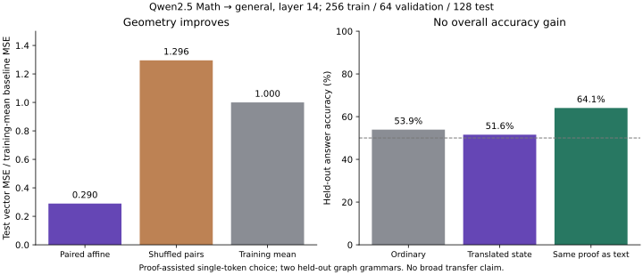

# Preparation checks and measured results

These records describe what was actually executed while preparing the starter on October 16, 2026, Pacific time. They are not results from a language model.

## Follow-up runs

The [LF-001 reproduction record](../artifacts/lf-001/reproduction.json) contains fresh seed-7 and seed-19 JSON results, plots, environment versions, commands, source hashes, and the 23-test passing log. Every result field agrees with the bundled reference at relative tolerance `1e-8` and absolute tolerance `1e-10`; the largest absolute numeric difference is below `2.2e-13`. Both predefined seeds were retained, and preprocessing and recipient decoding used training data only. This run used Python 3.14.7, NumPy 2.5.4, and Matplotlib 3.11.2 on macOS arm64.

The separate [LF-002 Lean-verification record](lf-002-lean-verification.md) supersedes the preparation-time missing-Lean limitation below: real Lean 4.35.0 verified all 60 generated examples and both proof variants, with 120 recognized zero-axiom audits. Corrupted inputs failed, missing Lean remained `not_run`, and all 12 logic/checker tests passed. Inputs, checked records, and unedited logs are retained under [`results/lf-002/`](../results/lf-002/). No generator or checker fixes were needed.

## Executed successfully

- Editable package build and installation with existing dependencies.
- **23 Python unit and integration tests passed** on Python 3.12.14, NumPy 2.3.5, and Matplotlib 3.10.8.
- Python compilation of source, experiments, and tests.
- Artificial alignment experiments with seeds 7 and 19.
- Deterministic generation of three examples per formal-data split, nine examples total, with Python graph certificates and controlled renderer round trips checked.
- Missing-Lean behavior: checker returned exit code 2, zero Lean-verified records, three `not_run` records, and no fabricated compiler success.
- Optional activation collector and fitter help commands and static Python checks; numeric fitter integration tests use fake collected arrays.
- Interactive report build, JavaScript syntax check, internal-anchor checks, and HTML structure checks. Browser rendering was unavailable, so no screenshot-based visual review is claimed.

Tests cover held-out affine recovery, wrong anchors, training-only preprocessing, rigid alignment, semantic ambiguity, graph/proof certificates, renderer mismatches, split leakage, corrupted archives, missing Lean, stale compiler metadata, and exit-zero output without an axiom audit.

## Artificial alignment results

The toy uses 256 training and 256 test points, 12 source dimensions, 8 target dimensions, 4 planted shared factors, and Gaussian noise with standard deviation 0.01. Normalized RMSE uses per-coordinate target scales fitted on training data only.

| Seed | Paired affine nRMSE | Shuffled-anchor nRMSE | Training-mean nRMSE | Paired task accuracy | Shuffled-anchor task accuracy |
| --- | --- | --- | --- | --- | --- |
| 7 | 0.009702 | 1.068365 | 1.060576 | 100% | 68.36% |
| 19 | 0.006754 | 1.068165 | 1.002256 | 100% | 31.25% |

The task is the sign of a planted linear combination of latent factors. The target-space decoder is fitted on training data. The paired 100% result is unsurprising in this deliberately favorable construction. The changing shuffled accuracy illustrates why multiple seeds and the primary regression metric should be retained.

The symmetric-cloud counterexample has effectively zero unpaired geometric error and exact round trips under both identity and half-turn maps. Planted semantic-label accuracy is 100% for identity and 0% for the half-turn. These maps are hand-specified; this is an exact ambiguity example, not a learned-model benchmark.

Reproduce from the repository root:

```bash
python -m unittest discover -s tests -v
python experiments/toy_alignment.py --seed 7 --output artifacts/toy_alignment_seed7.json
python experiments/toy_alignment.py --seed 19 --output artifacts/toy_alignment_seed19.json
python experiments/generate_logic.py --count 3 --seed 7 --output-dir examples/logic
```

## Not executed during preparation

| Item | Actual status | Next action |
| --- | --- | --- |
| Real Lean compilation | Lean not installed in preparation environment | Run LF-002 and retain axiom audits |
| Actual model downloads/inference | No weights downloaded; torch/transformers unavailable | Run the small collector pilot from the model plan |
| Real-model alignment | Numeric integration tests only | Collect source/recipient activations, then fit |
| Activation intervention | Not implemented | Implement identity/oracle intervention before translation |
| Student training or distillation | Not run | Establish the dataset and matched baseline first |
| Adaptive self-play | Not implemented | Compare only after a useful fixed baseline exists |
| GitHub-hosted CI | Workflow supplied, not run on a remote repository | Inspect the first run after upload |
| GitHub repository/domain purchase | No remote created and no domain purchased | User launch checklist |

The source pair suggested for the next milestone is a small mathematical/general model pair, not a certified Lean prover. Actual proof checking always remains separate.

## First actual-model experiment

The first real run tested a narrow proof-assistance question: can an affine
bridge convey a supplied verified certificate to a general model more usefully
than the exact same certificate supplied as text? This differs from transferring
pretrained mathematical skill under equal-information prompts. The source was
`Qwen/Qwen2.5-Math-1.5B` at revision
`4a83ca6e4526a4f2da3aa259ec36c259f66b2ab2`; the recipient was
`Qwen/Qwen2.5-1.5B` at revision
`8faed761d45a263340a0528343f099c05c9a4323`. Exact upstream licenses and
configurations are retained in [`artifacts/llm-runtime/`](../artifacts/llm-runtime/).

The [registered plan](../artifacts/real-model-plan.json) fixed the model pair,
layer, data sizes, regularization grid, controls, and metrics before inference.
Both models saw identical proof-assisted collection prompts. During answer
evaluation, the ordinary recipient saw the question and rules without the
certificate, while the text baseline saw the exact complete donor prompt.
Thus this is explicit evidence compression and assistance, with no claim that
the recipient acquired mathematical knowledge.

### Data and collection

CPU smoke runs checked three inputs per model. The separate 30-pair pilot
used 10 train, 10 validation, and 10 test prompts from the original checked
corpus. It validated collection rather than capability; its fitted map did not
beat the mean baseline. The pilot's topology/template confounds remain explicit.
All pilot outputs are retained in [`artifacts/activation-pilot/`](../artifacts/activation-pilot/).

The expanded fixed dataset used 256 training, 64 validation, and 128 test
examples. Every one of these 448 examples has two real Lean-checked proofs,
for 896 recognized zero-axiom audits. The generated and separately checked
records, logs, and [verification hashes](../data/transfer-v1/verification.json)
are retained under [`data/transfer-v1/`](../data/transfer-v1/). The main task has
two equal-length candidate rule chains, one valid and one invalid; it avoids
trivial binary reachability accuracy.

Answer labels are not exactly balanced: train has A: 121 / B: 135, validation
A: 32 / B: 32, and test A: 63 / B: 65. Always choosing the training-majority label B yields 50.78%
on test. The two test grammars, rather than the answer labels, have exactly
64 items each.

Training holds parallel-route graphs, validation holds triple-route graphs,
and test holds chained diamonds and cyclic chained diamonds (64 test items
each). All use the same controlled renderer and lexicon. Renamings are grouped
by rooted route-length/cycle/distractor signatures: 48 train, 31 validation,
and 69 test lineages. These are construction-specific structural signatures,
not a generic graph canonicalizer. Only two held-out grammars are represented.

Sequential collection used float32, MPS, batch size 1, literal prompts without
chat templates, and the last nonpadding token at `hidden_states[14]` (after
decoder block 13). Tokenizer fingerprints and every input/token hash matched.
The [collection record](../artifacts/transfer-v1/collection-summary.json)
reports about 164 seconds per model on an Apple M5 Pro with 24 GiB RAM, peak
process RSS about 9.73 GB, and sampled MPS driver allocation about 7.43 GB.
Sampled allocator counters are not continuous peak measurements. No paid
compute was used. Exact runtime versions and commands are retained alongside
the manifests.

### Geometric alignment

The train-only affine ridge map used the fixed alpha grid
`0.0001, 0.001, 0.01, 0.1, 1.0`. Validation selected `1.0`; the map was not
refitted on validation or selected using test answers.

| Test metric | Paired affine | Shuffled training pairs | Training mean |
| --- | ---: | ---: | ---: |
| Vector MSE | 0.000943 | 0.004217 | 0.003255 |
| MSE / mean-baseline MSE | 0.290 | 1.296 | 1.000 |
| Normalized RMSE | 0.676 | 1.265 | 1.126 |
| Matched-vector retrieval, 128 candidates | 82.81% | 0.78% | 0.78% |

Chance retrieval is 0.78%. Mean-output cosine similarity was already 0.99888,
illustrating why high raw cosine alone would be misleading. Complete validation,
test, per-family, and raw-identity results are in the
[affine report](../artifacts/transfer-v1/affine-results.json).

### Answer usefulness

Only one next answer token was scored. Continuations ` A` and ` B` preserve
the complete prompt prefix and are single tokens, IDs 362 and 425 in both
tokenizers. Two-choice accuracy and full-vocabulary answer-token negative log
likelihood were fixed metrics. Greedy-token accuracy was also recorded and
equaled two-choice accuracy on this run.

| Method | Accuracy on 128 test items | Answer-token NLL |
| --- | ---: | ---: |
| Ordinary recipient | 53.91% | 0.82566 |
| Same proof supplied as text | 64.06% | 0.79500 |
| Translated donor state | 51.56% | 0.80018 |
| Self-patch recipient | 53.91% | 0.82566 |
| Shuffled training-pair map | 53.13% | 0.79955 |
| Shuffled donor rows | 53.13% | 0.80270 |
| Translated zero donor, `T(0)` | 54.69% | 0.79381 |
| Recipient training-mean state | 52.34% | 0.80075 |
| Exact recipient proof-text state patched into the ordinary prompt | 53.91% | 0.80052 |
| Raw identity donor state | 50.00% | 0.98862 |
| Math source with the supplied proof, reference only | 50.78% | 1.17053 |

All 128 self-patches passed the declared `atol=rtol=1e-4` logit tolerance;
maximum absolute logit difference was `4.77e-5`. The runtime layer state also
matched the separately collected interface at that tolerance. Cached causal
prefix replay passed for every item. Donor-row shuffling used a seeded random
derangement, and `T(0)` is the affine intercept rather than a zero recipient
vector. No intervention mixing strength or layer was tuned on test.

The translated state had a slightly better answer-token NLL than the ordinary
recipient but lower answer accuracy. It trailed proof-text accuracy by 12.5
percentage points. A paired bootstrap over the 69 underlying lineages gave a
conditional 95% interval of about [-20.8, -5.1] points for translated minus text,
and [-9.8, +5.1] points for translated minus ordinary. These intervals condition
on only two chosen grammars; they do not establish broad family-level effects.

The exact proof-text state patch also failed to reproduce the full text
benefit, suggesting a limitation of this one-position interface and its retained
ordinary-prompt attention context. It does not isolate affine-map error as the
only cause. The math model itself was near chance on this choice format, so
this run did not establish a strong answer-producing teacher. No matched
end-to-end inference-cost or multi-token generation advantage is claimed.

Per-example scores, per-family metrics, hashes, memory and timing are retained
in the [recipient report](../artifacts/transfer-v1/recipient-evaluation/results.json)
and [source report](../artifacts/transfer-v1/source-evaluation/results.json).



### Fixed-data student

The [student plan](../artifacts/student-plan.json) fixed a 539,437-parameter,
two-layer, 128-dimensional causal next-token student initialized from scratch.
It saw only the question and rules, without the supplied certificate, source
model, or translator. It used the same structural train/validation/test split.

Three seeds were retained. Within each seed, verified-supervision and
label-permutation arms used identical starting weights, prompts, batch order,
architecture, 96 optimizer updates, 768 supervised answer tokens, and input
and padding token counts. Settings were fixed for three epochs, without
validation selection or early stopping. The control isolates correct answer
supervision; it is not a comparison against equally useful ordinary text.

| Seed | Verified supervision test accuracy | Permuted-label control |
| --- | ---: | ---: |
| 1729 | 40.63% | 50.78% |
| 1730 | 50.78% | 47.66% |
| 1731 | 51.56% | 49.22% |
| Mean | 47.66% | 49.22% |

The fixed dataset did not improve held-out accuracy in this small-student
setting. All six checkpoints were retained with hashes and reloaded in separate
processes; every test prediction reproduced without either Qwen model present.
Full budgets, validation/test rows, and checkpoint references are in the
[student report](../artifacts/student-v1/results.json) and
[reload records](../artifacts/student-v1/reloaded/). No iterative generation or
general-model distillation was run.

### Reproduction and review

The original [15-example correspondence sheet](example-audit.html) has coding-agent
manual review and retains human review as pending. Agent review and Lean
verification do not substitute for a human English-correspondence audit.

Collection commands are in [`artifacts/transfer-v1/commands.json`](../artifacts/transfer-v1/commands.json).
Fitting, answer evaluation, student training, and checkpoint reload commands are
in the [experiment command record](../artifacts/transfer-v1/experiment-commands.json).
The original baseline release remains immutable; later source changes are
identified by Git history and execution-time source hashes. Frozen-model
weights stay outside Git. Raw small activation arrays, the affine map, and
student checkpoints are packaged separately from the source snapshot.

The justified result is narrow: this map learned a useful geometric match on
the chosen held-out graph structures, but this single-position proof-assistance
interface did not beat the same proof as text, and the small fixed-student
trial showed no gain over its matched label control.

A [second coding-agent review](../artifacts/transfer-v1/independent-review.json)
independently reproduced the dual ridge fit, row-level scores, conditional
intervals, student budgets and hashes, and a real-Qwen self-patch control. The
independent cached self-patch error was `1.86e-5`, and the full-prompt self-patch
error was zero. This remains agent review; it does not fill the pending human
correspondence signoff.
